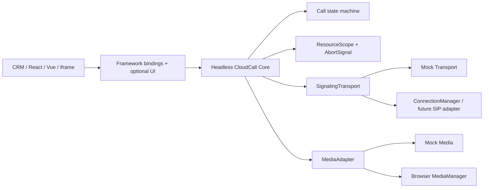

# 架构设计

Core 只依赖注入的接口，不依赖 DOM、React、Vue 或 SIP.js。`CloudCallSDK` 是 Facade；`CallSession` 串行化同一会话上的用户命令；纯函数 `transition` 是唯一状态转换入口；`ResourceScope` 统一取消异步任务和释放连接、订阅及计时器。

## 关键链路

拨号请求先校验生命周期、号码和并发容量，再创建 session 并发送命令。Mock/真实 transport 产生带 `messageId` 与可选 `sequence` 的事件；SDK 先做实例代际、销毁和重复消息校验，CallSession 再做序列与合法转换校验。远端接通必须先成功获取媒体；若此时用户挂断或 SDK 销毁，AbortSignal 阻断回写并释放晚到媒体。

## 可靠性语义

- WebSocket 仅保证帧传输，不保证业务“恰好一次”。接收侧以 messageId 去重。
- 默认不缓存拨号、接听、挂断等非幂等控制命令；仅显式 `replaySafe` 的消息进入发送队列。
- 请求以 correlationId 关联，超时或 Abort 后删除 pending；过期响应不会再影响业务。
- 乱序事件以服务端 sequence 抛弃旧版本。没有 sequence 时依靠状态机拒绝非法转换。
- 本地挂断同步进入终态，晚到的 REMOTE_ACCEPTED 不能复活会话。

## 多实例和包边界

每个 SDK 实例拥有独立事件总线、去重集合、调用表和 ResourceScope。包发布为 ESM + 声明 + source map；React/Vue 是 peer dependency，UI 样式单独标记 side effect。模块依赖方向固定为宿主/绑定 → Core 接口 ← adapter，不产生环。

## ADR

### ADR-001：自研小型显式状态机，而非 XState

项目状态规模有限，自研纯 reducer 保持 Core 零运行时依赖、产物小且测试直接。代价是复杂并行状态需自行扩展；若未来加入咨询转接/会议等正交状态，再引入 XState actor 模型。

### ADR-002：销毁后不可重新初始化

复活同一实例会混淆旧请求、旧序列号与监听器代际。创建新实例成本低，语义更确定。

### ADR-003：Transport/Media/Host 全部依赖注入

便于浏览器、iframe 和测试环境替换基础设施，且 Core 不接触生产凭证。代价是接入方必须实现契约。

### ADR-004：不自动重放通话控制

断线后的 `hangup`/`dial` 是否已被服务端执行不可知，自动重放可能产生第二通电话。失败后应先执行状态同步，再由业务决定补偿。

### ADR-005：React UI 可选

核心能力能被原生 JS、Vue 和 iframe 使用，避免 React 版本冲突与不必要包体积；代价是绑定层需要维护一致的订阅约定。

### ADR-007：座席产品能力留在 SDK 端口

见 [docs/adr/007-softphone-product-ports.md](adr/007-softphone-product-ports.md)。咨询转接、会议、队列和回呼继续留给真实 PBX/ACD。
