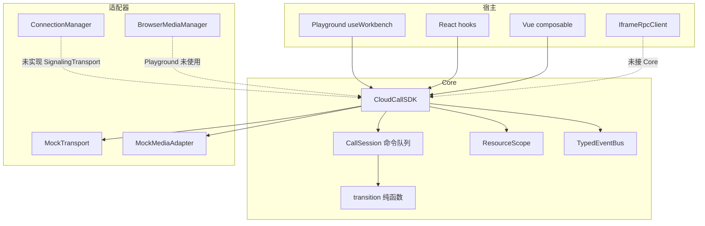

# 第一阶段：项目架构与证据

分析范围是仓库当前树，外加提交 `869866a`。结论分成三档：

- **已实现**：源码里有，并且有测试或调用路径能对上。
- **有缺陷**：源码里有，但行为不完整、未接线，或和注释/文档不一致。
- **未实现**：类型、ADR 或旧文档提到，运行路径里没有。

本轮执行了 `pnpm test`（Vitest 3.2.7，13 个测试通过）和一次 `pnpm benchmark`。没有跑 Playwright，也没有接真实 PBX。

## 1. 业务问题与目标用户

README 把项目定义成面向 CRM、销售管理和呼叫中心的云呼叫前端 SDK **参考实现**。Playground 用真实 Core 加上明确标记的 Mock 信令/媒体适配器。

从代码能确认的用户是“宿主应用里的前端集成方”，不是通话中的最终客户本人：

- 宿主通过 `createCloudCall({ transport, media, host })` 拿到 `CloudCallSDK`（`packages/core/src/sdk.ts` 的 `createCloudCall`）。
- React 绑定只提供 Provider 和订阅（`packages/react/src/index.tsx`）。
- Vue 绑定只把 SDK 快照放进 `shallowRef`（`packages/vue/src/index.ts`）。
- iframe 侧只有 `IframeRpcClient`（`packages/iframe/src/index.ts`），没有宿主页面，也没有服务端协议实现。
- Playground（`apps/playground`）是开发者工作台：软电话、会话、状态机、日志、故障开关。

**不能从代码推出的内容**：客户数、通话量、接通率、线上事故、你在公司的职级和分工。面试时不要补这些数字。

## 2. 技术栈与依赖方向

根 `package.json`：pnpm 12.11.2、Node `>=22`、TypeScript 5.9、Vitest 3.2、Vite 7、Playwright、ESLint 9、Prettier、Changesets、tsup。React 19 和 Vue 3.5 是根上的 devDependency；框架包把它们声明为 peerDependency。

| 包 | 依赖谁 | 实际职责 |
| --- | --- | --- |
| `@cloudcall/core` | 无运行时业务依赖 | Facade、状态机、会话、事件总线、ResourceScope |
| `@cloudcall/signaling` | core | `ConnectionManager`、`MockTransport` |
| `@cloudcall/webrtc` | core | `BrowserMediaManager`、`MockMediaAdapter` |
| `@cloudcall/react` / `vue` | core，框架为 peer | 薄绑定 |
| `@cloudcall/ui` | core，React 为 peer | `CallControls`、`StatusBadge`；`sideEffects` 只标记 CSS |
| `@cloudcall/iframe` | 无 | `postMessage` RPC 客户端 |
| `apps/playground` | core + signaling + webrtc + ui | Mock 工作台 |
| `apps/react-demo` / `vue-demo` | 对应绑定 | 各一个示例组件，没有独立业务 |

构建：每个包用 tsup 打 ESM、声明文件和 source map。`tsconfig.base.json` 打开了 `strict`、`noUncheckedIndexedAccess`、`exactOptionalPropertyTypes`、`verbatimModuleSyntax`。CI（`.github/workflows/ci.yml`）在 Node 22 上执行 `pnpm run ci`，也就是 lint、typecheck、test、build。E2E 不在 CI 脚本里。

依赖方向是宿主/适配器 → Core 接口。Core 不 import React、Vue、SIP.js 或 DOM 呼叫 API。signaling 和 webrtc 反过来依赖 core 的类型。这条方向在 package.json 里成立。仓库没有 dependency-cruiser 之类的自动环检测。

## 3. 运行时结构

`docs/architecture.md` 里的图把 ConnectionManager 画在 Transport 后面。源码里 **没有** 任何一个类把 `ConnectionManager` 适配成 `SignalingTransport`。Playground 只 `new MockTransport()` 和 `new MockMediaAdapter()`（`apps/playground/src/use-workbench.ts`）。

## 4. 核心流程

### 4.1 SDK 生命周期

`CloudCallSDK` 的状态：`created → initializing → ready`，失败为 `failed`，销毁为 `destroying → destroyed`。

`init()`（`sdk.ts`）：

1. `ready` 直接返回；`initializing` 复用同一个 `initPromise`；`destroyed` / `destroying` 拒绝。
2. 把当前 `ResourceScope` 记为 `generation`。
3. `await host.getAccessToken(signal)`，返回值没有传给 transport。
4. `await transport.connect(signal)`。
5. 若 signal 已中止，抛 `DESTROYED`，避免写入 `ready`。
6. 订阅 transport，并把 `transport.disconnect` 登记进 scope。

`destroy()`：先把所有会话 `apply({ type: 'DESTROY' })`，再 `scope.dispose()` 和 `media.destroy()`，最后清空 calls、seenMessages、总线，状态定为 `destroyed`。重复 destroy 直接返回。测试 `deduplicates init and destroy` 覆盖了并发 init/destroy。

`failed` 之后可以再调 `init()`。Playground 的“重试”走这条路径。销毁之后必须 `key` 换新实例（`apps/playground/src/App.tsx` 的 `epoch`），因为实例不会复活。这是 ADR-002，代码和 UI 一致。

### 4.2 拨号

`dial()`：

1. `assertReady()`。
2. 统计非 `ended` / `failed` 的会话数，超过 `maxConcurrentCalls`（默认 2，Playground 配 3）抛 `CAPACITY`。
3. 号码必须匹配 `/^\+?[0-9*#]{3,20}$/`，否则 `VALIDATION`。
4. `createCall`，初始状态 `connecting`，revision `0`。
5. `transport.send({ type: 'dial' })`。
6. **send 成功之后**才登记振铃超时（默认 30 秒，Playground 15 秒）。

Mock 拨号在 `MockTransport.send` 里延迟后发出 `REMOTE_RINGING`（sequence 1）和 `REMOTE_ACCEPTED`（sequence 2）。乱序开关会把 sequence 2 的接通排在 sequence 1 的振铃前面。

### 4.3 入站事件

`handleTransportEvent`：

- scope 不是当前 scope、signal 已中止，或状态不是 `ready`：丢弃。销毁后的晚到事件由 `sdk.test.ts` 的 `ignores late signals after destroy` 覆盖。
- `incoming`：按 call id 创建 `incoming` 会话，不查 messageId。
- `call-event`：`seenMessages` 按 `messageId` 去重，再 `call.applyRemote(event)`。

`CallSession.applyRemote`：若事件是 `REMOTE_ACCEPTED` 且会话还没终态，先 `media.acquire`。获取完成后再看 signal 和终态；若已经挂断或销毁，`release` 并且 **不** 把接通写回。其他事件直接 `apply`。

`apply` 调用纯函数 `transition`。终态再次转换返回原快照。非法转换抛 `CloudCallError('INVALID_STATE')`。带 `sequence` 且 `sequence <= revision` 的事件丢弃。

### 4.4 本地命令

`accept / reject / hangup / hold / resume` 进入 `command()`，再进入 `enqueue()`。同一会话的 Promise 链保证用户命令按调用顺序执行。`mute`、`sendDtmf`、`transfer` 也走 `enqueue`，但不走同一套状态事件。

`command()` 在队列任务内部、`await send` 之前调用 `apply(event)`。注释写的是本地意图先落地，晚到的 `REMOTE_ACCEPTED` 会被终态挡住。这个“同步”只发生在任务真正开始执行之后。前面如果还有未完成的命令，后到的 `hangup()` 会在队列里等待，见故事 5。

## 5. 状态、数据与事件

| 数据 | 位置 | 谁可以改 |
| --- | --- | --- |
| SDK 状态 | `CloudCallSDK.state` | `setState` |
| 会话快照 | `CallSession.snapshot` | 只有 `transition` 的返回值，外加 `mute` 直接改 `muted` |
| 会话表 | `calls: Map` | `createCall`；`destroy` 时清空。终态会话不删除 |
| 去重集 | `seenMessages` | 每条 call-event 插入，只在 destroy 清空 |
| 命令队列 | `CallSession.operation` | `enqueue` |
| UI 列表 | Playground / React / Vue 各自的 state | 订阅 `call:created` 和 `call:updated` 后整表 `getCalls()` |

事件总线是 `TypedEventBus`：`on` 返回退订函数，`emit` 时拷贝监听器数组，避免回调里退订打乱遍历。SDK 事件有 `sdk:state`、`call:created`、`call:updated`、`call:ended`、`error`。源码里没有 `bus.emit('error', ...)`。

快照是拷贝出去的（`getSnapshot` 返回浅拷贝）。状态机不修改入参。`mute` 是例外：它不经过 `transition`，直接替换 `muted` 再通知。静音没有信令命令。

Playground 通话时长用 `(endedAt ?? now) - connectedAt`，`now` 每秒更新。时长不靠 interval 累加，所以定时器被节流时，下一次计算仍基于时间戳。这只存在于 `MachineView`，不是 Core 的能力。

## 6. 状态机实际能走到的状态

`CallState` 声明了 9 个状态。`transition` 真正会写入的是：

| 状态 | 谁把它写出来 |
| --- | --- |
| `connecting` | `dial` 的初始快照 |
| `incoming` | 入站 `incoming` 事件的初始快照 |
| `ringing` | `REMOTE_RINGING` |
| `active` | `REMOTE_ACCEPTED`、`ACCEPT`、`RESUME`、`NETWORK_RESTORED` |
| `holding` | `HOLD` |
| `reconnecting` | `NETWORK_LOST` |
| `ended` | `HANGUP`、`REMOTE_HANGUP`、`REJECT`、`TIMEOUT`、`DESTROY` |
| `failed` | `FAIL` |
| `ending` | 没有任何赋值。白名单里有这个状态，迁移进不去 |

`NETWORK_LOST` / `NETWORK_RESTORED` 没有生产调用点。Mock 和 ConnectionManager 都不会把掉线翻译成这两个事件。`endReason: 'network-error'` 同样没有赋值，`FAIL` 固定写成 `signaling-error`。

## 7. 网络、并发、异常、资源

### 已实现

- **同一会话用户命令串行**：`CallSession.enqueue`。上一条失败不会卡住下一条，因为 `then(task, task)`，内部链再用 `catch` 吞掉，调用方仍拿到原始拒绝。
- **实例级取消**：`ResourceScope` 持有一个 `AbortController`。`dispose` 先 abort，再逆序 `Promise.allSettled` 执行 disposer。第一个拒绝会被重新抛出。
- **超时登记**：`scope.timeout` 把 `clearTimeout` 放进 disposer。
- **媒体取消**：`BrowserMediaManager.acquire` 在 `getUserMedia` 返回后如果 signal 已中止，会 `track.stop()` 再抛出。终态 `apply` 会 `media.release`。
- **消息去重**：SDK 用无上限 `Set`；`ConnectionManager` 用上限 1000 的 `Set`，超出删最早插入的 id。
- **请求关联**：`ConnectionManager.request` 用消息 `id` 当 correlationId，超时或 abort 时从 `pending` 删除。过期响应找不到 pending，直接忽略。
- **非安全重放**：`ConnectionManager.send` 在未连接时，只有 `replaySafe === true` 才入队。否则抛错。心跳 ping 传了 `true`。测试只覆盖“未连接时 hangup 抛错”和“并发 connect 只建一次 socket”。
- **重连**：`onclose` 且不是用户主动关闭时，`baseDelayMs * 2^attempt` 再乘 `Math.random()`，上限 15 秒，默认最多 6 次。这是 AWS 风格的 full jitter（睡眠时间落在 `[0, cap]`）。旧 socket 用 `socket !== this.socket` 忽略过期回调。
- **iframe**：校验 `event.origin`、`event.source` 和 `protocol === 'cloudcall.rpc.v1'`，`postMessage` 使用明确的 `targetOrigin`。超时和 `destroy` 会拒绝 pending。

### 有缺陷

- `dial` 在 `send` 之前就已经 `createCall`。send 失败时调用方看到拒绝，会话仍停在 `connecting`，而且振铃超时还没登记，这条会话会一直占着并发名额。
- 振铃超时到点后，只跳过 `active`、`ended`、`failed`。会话若已是 `holding`，仍会 `apply(TIMEOUT)`，而 `holding` 的白名单没有 `TIMEOUT`，回调里会抛 `INVALID_STATE`。若已是 `reconnecting`，超时合法，会把已经接通过的电话以 `timeout` 结束。定时器在进入 `active` 后没有取消。
- `applyRemote` 不进命令队列。`REMOTE_ACCEPTED` 在 `await acquire` 之后、`apply` 之前没有再次让出事件循环，所以单线程下“检查终态”和“写入”之间不会插进别的任务。两条不同 `messageId` 的接通可以同时通过 `!isTerminal` 检查，双双 `acquire`。第二条再 `apply` 会抛非法转换。`handleTransportEvent` 使用 `void call.applyRemote(...)`，这个拒绝没有接住。`BrowserMediaManager` 用 `streams.set(callId, stream)` 覆盖，第一条轨道可能没人 `stop`。
- `seenMessages` 只增不减，直到 destroy。ConnectionManager 的 1000 上限不适用于 SDK 这条路径。
- 终态会话留在 `calls` 里。并发统计会排除它们，内存不会排除。
- `getAccessToken` 的字符串被丢掉，transport 看不到凭证。
- `ConnectionManager` 没有入站消息回调。非 correlation 响应在去重后被丢弃，所以它现在还不能驱动通话事件。
- `ConnectionManager.scheduleReconnect` 不清理上一个 `reconnectTimer`。
- Mock 的 `setTimeout` 发出的振铃/接通没有挂到 AbortSignal 上。销毁后靠 SDK 的状态检查丢掉；会话还在时，这些定时器仍会触发。
- `IframeRpcClient.request` 不看 `ready`。仓库里没有 iframe 子页面。
- React 绑定用 `useState` + `useEffect`，没有 `useSyncExternalStore`。Vue 绑定卸载时只退订，不 `destroy` SDK；React Provider 卸载时会 `destroy`。两边语义不一样。

### 未实现

- SIP.js、`RTCPeerConnection`、ICE、STUN/TURN、`getStats`。`QualitySample` 类型没有引用。ADR-006 把这些标成后续适配器。
- 重连后的服务端快照同步。
- 输入设备 `replaceTrack`。`setOutputDevice` 只对一个空的 `Audio` 元素调用 `setSinkId`，没有远端音轨。
- `SdkEvents['error']` 的发送方。
- 转接状态。`transfer` 只在本地校验后 `send('transfer')`。Mock 对非 dial 命令不会制造后续事件，所以 Promise 成功只表示 Mock send 没抛错。

## 8. 测试与基准

| 证据 | 覆盖了什么 | 没覆盖什么 |
| --- | --- | --- |
| `call-machine.test.ts` 4 例 | 终态忽略晚到接通、旧 sequence 丢弃、非法 HOLD、重复挂断返回同一快照 | 整表迁移、`ending`、超时与 holding 的组合 |
| `sdk.test.ts` 3 例 | 并发 init/destroy、销毁后晚到事件、双实例隔离 | messageId 去重、容量、号码校验、send 失败回滚 |
| `stress.test.ts` 1 例 | 100 次 init/destroy 后 `diagnostics()` 为 destroyed、0 calls、0 listeners、0 seenMessages | 堆快照、轨道、socket |
| `connection-manager.test.ts` 2 例 | 离线 hangup 不入队、并发 connect 一次 | 心跳、退避、去重上限、请求超时、过期响应 |
| `webrtc/index.test.ts` 2 例 | Mock 媒体销毁和权限拒绝 | `BrowserMediaManager` |
| `ui/index.test.tsx` 1 例 | 来电按钮文案 | 点击行为 |
| `playground.spec.ts` 1 例 | Mock 拨号到 ringing、active、挂断后 ended | 故障开关、来电、刷新 |
| `call-machine.bench.ts` | 纯 `transition` 两次调用 | 端到端耗时 |

2026-10-13 本机一次 `pnpm benchmark`（Vitest 3.2.7，Windows）：`connecting → ringing → active` 约 5.14e6 ops/s，mean 0.0002 ms，rme ±0.82%，样本约 257 万。这只说明纯函数在这次运行里很快。没有优化前后的对照，不能写成性能优化成果。CPU 型号未记录。

## 9. 工程化现状

已有：workspace、严格 TS、ESLint、Prettier、Changesets 配置、ESM 产物、source map、CI 四步、Playwright 配置（企业代理下给 localhost 设了 `NO_PROXY`）。

没有：发布过的版本记录、包体积预算、浏览器兼容矩阵、真实媒体设备测试、契约测试、状态机模型测试。E2E 需要单独 `pnpm test:e2e`，并且首次要装 Chromium。

## 10. 和旧文档不一致的地方

读代码时以源码为准，不要背这些旧句子：

- “React 绑定使用 useSyncExternalStore”。实际是 `useEffect` 订阅。
- “输入设备用 replaceTrack 切换”。没有 `replaceTrack`。
- “getStats 已按窗口聚合”。只有未使用的 `QualitySample` 接口。
- “去重集合限制 1000”。只有 `ConnectionManager` 有这个上限。
- “Core 已经通过 ConnectionManager 收发通话事件”。两者没有适配器。
