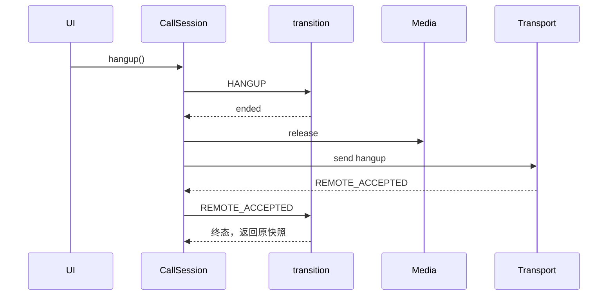
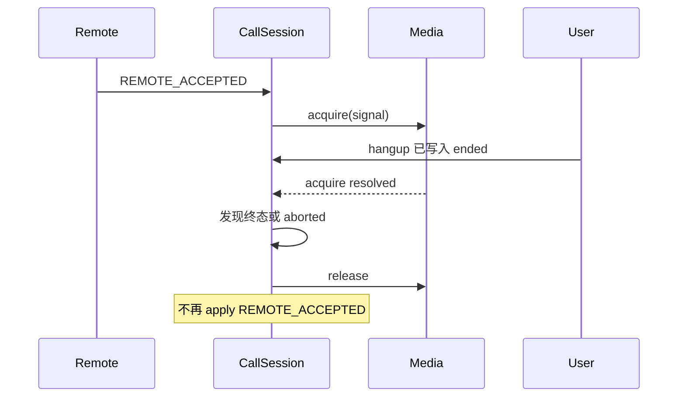
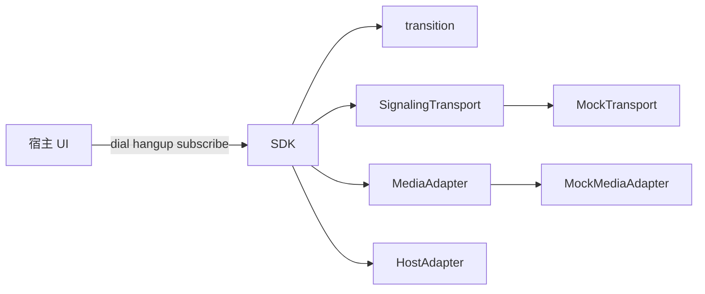

# 第三阶段：技术故事

贡献边界见 [README](./README.md)。每个追问末尾标注证据级别：

- **代码已证明**：当前仓库能直接指给面试官看。
- **需要我补充**：行为合理，但测试、线上数据或产品约束不在仓库里。

---

## 故事 1：本地挂断与晚到接通

### 1. 一句话亮点

通话会话用显式状态机把挂断做成不可逆终态，并在远端接通写回前先取得媒体；媒体返回时若用户已经挂断或实例已销毁，则释放轨道且不复活会话。

### 2. 业务背景

软电话同时存在两条写入路径：用户点击挂断，以及信令稍后送达“已振铃 / 已接通”。Mock 把这两条路径做成了可注入延迟的真实调用链，而不是在按钮 onClick 里直接 `setState('ended')`。

现实约束来自代码形态：

- 信令是异步的。`MockTransport.send` 先 `delay`，再用 `setTimeout` 发事件。
- 媒体权限也是异步的。接通前要 `media.acquire`。
- 浏览器里 `getUserMedia` 的弹窗可能晚于用户挂断才返回。`BrowserMediaManager` 在返回后检查 `signal.aborted`。

### 3. 目标与职责

要保证：一旦本地决定结束，后面的接通事件不能把 UI 拉回“通话中”；如果麦克风已经打开，必须停掉轨道。

仓库里承担这件事的是 `transition`、`CallSession.apply` / `applyRemote` / `command`，以及两个 MediaAdapter。Git 不能证明这是你在团队中的个人任务。

### 4. 核心技术难点

**难点 A：终态必须盖过任何晚到事件。**

困难在于两个来源没有共同的锁。普通写法是各自 `setState`：挂断设 `ended`，接通回调设 `active`，后完成的那个获胜。在 300 毫秒以上的模拟延迟下，这个窗口稳定存在。边界包括重复挂断、接通晚于挂断、销毁晚于接通回调。

**难点 B：接通不是一次赋值，中间夹着媒体获取。**

`applyRemote` 在 `REMOTE_ACCEPTED` 上先 `await media.acquire`。等待期间用户可以挂断。如果获取成功后再无条件 `apply(REMOTE_ACCEPTED)`，终态会被擦掉，并且麦克风已经打开。普通实现把“收到接通”和“进入通话中”写成一步，就会漏掉这个窗口。

**难点 C：本地挂断的“同步”只在命令任务开始之后成立。**

`hangup()` 把 `apply(HANGUP)` 放在队列任务里、`await send` 之前。队列空闲时，调用 `hangup()` 会在当前任务里立刻终态化，随后的网络失败也不会把终态改回去（失败补偿只在非终态时 `apply(FAIL)`）。队列里若还有未完成的 `hold` / `accept`，这次挂断要等前一个任务结束才写终态。

### 5. 解决方案



媒体仍在获取时：



关键结构：

- `legal` 表：每个状态一组允许的事件名。终态的集合是空的。
- `isTerminal` 时 `transition` 返回**同一个快照引用**。测试用 `toBe` 而不是深比较，所以能证明没有产生新对象。
- `sequence <= revision` 时同样返回原引用。这是故事 5 的机制，接通竞态本身不依赖序号。
- `apply` 发现 `next === snapshot` 就停止，不会二次通知，也不会在终态上再次 `release`。
- 进入终态时 `void this.media.release(id)`。释放是按 callId 幂等的：Mock 从 Set 删除，浏览器实现 `track.stop()` 后 `map.delete`。

选型：状态空间就是一条通话的互斥阶段，mute 放在快照字段上，不放进状态名。因此用纯函数加白名单，而不是 XState。ADR-001 写了这个取舍：零运行时依赖、测试可以直接喂事件；代价是正交状态要自己加。仓库里没有 XState。

替代方案：

| 方案 | 代价 |
| --- | --- |
| UI 自己管字符串状态 | 每个宿主写一套竞态，iframe 和 React 会分叉 |
| 布尔值 `isRinging`、`isActive`、`isEnded` | 可以同时为真 |
| 接通优先，挂断等服务端 ACK | 用户会看到挂断无效；ACK 丢失时更差 |
| 乐观挂断加回滚 | 需要服务端明确“挂断被拒绝”。当前协议没有这个事件 |

当前挂断是乐观终态：先本地 `ended`，再 `send('hangup')`。send 失败时因为已经终态，不会改成 `failed`，只把错误抛给调用方。调用方可能看到 Promise 拒绝，但快照已经是 `ended`。

### 6. 最终结果

**已验证**

- `call-machine.test.ts`：挂断后的 `REMOTE_ACCEPTED` 返回原快照；重复挂断返回原快照；`connecting` 上 `HOLD` 抛错。
- `sdk.test.ts`：destroy 之后再投递 `REMOTE_ACCEPTED`，快照仍是 `ended`。
- `BrowserMediaManager.acquire` 的源码在 signal 已中止时停止轨道。这条没有测试。

**没有证据的业务结果**

没有接通率、误显示次数或客诉数据。不要写“减少了多少幽灵通话”。

**可以测但还没测**

- 挂断发生在 `acquire` 的 await 中间，断言 `release` 被调用且状态不是 `active`。
- 两条不同 messageId 的 `REMOTE_ACCEPTED` 并发到达。
- `hold` 进行中再 `hangup`，终态写入的时刻。
- 拨号超时触发时会话已经是 `holding`。

**遗留问题**

- 命令队列非空时，`hangup()` 返回的那一刻终态还没写上。
- 双接通可以让 `acquire` 进入两次；第二次 `apply` 抛错，且 `void applyRemote` 没有 `catch`。
- `dial` 的超时回调没有在进入 `active` 时取消。`holding` 不在跳过列表里，`TIMEOUT` 又不在 `holding` 白名单里，到点会抛 `INVALID_STATE`。
- `ending` 状态没有入口。挂断直接到 `ended`，不存在“正在挂断、等待 ACK”的阶段。

### 7. 面试口述稿

**30 秒**

云呼叫里用户挂断和信令接通会交错到达。我把通话收成一张显式状态表，本地挂断同步进终态，终态上任何事件都原样返回。接通还要先拿麦克风；如果等待期间已经挂断或 SDK 销毁了，就停掉轨道，不再把状态写成通话中。

**2 分钟**

宿主点挂断和信令回接通是两条异步路径。如果 UI 各写各的 setState，后到的接通会把已挂断的电话画回去。

Core 里只有 `transition` 能改通话阶段。挂断事件把 `connecting` 或 `ringing` 记成取消，把已接通记成本地挂断，状态都是 `ended`。终态的合法事件是空集，函数直接返回原快照，所以晚到的接通不会生成新状态，也不会再次通知 UI。

接通比其他事件多一步。`applyRemote` 先向媒体适配器要麦克风，并且带上实例的 AbortSignal。等待回来以后，先看是不是已经终态或已经销毁；是的话释放媒体，放弃这次接通。浏览器实现还会在 `getUserMedia` 返回后检查 signal，避免弹窗晚到时把灯留着。

单测覆盖了“挂断后的接通返回同一对象”和“销毁后再投递接通仍是 ended”。我不会把这件事说成线上接通率变化，因为仓库里没有这个数。另外，挂断如果排在一条还没完成的 hold 后面，终态要等队列轮到它才写入。这是我后面要补测试的点。

**5 分钟**

在两分钟版本上把写入路径拆开。

用户命令进 `CallSession.enqueue`。这个队列是一条 Promise：`operation.then(task, task)`，失败不阻塞下一条，调用方仍能接到拒绝。`hangup` 的任务里，先 `apply(HANGUP)`，再 `send`。所以一旦任务开始，本地终态早于网络。send 失败时，补偿逻辑看到已经终态，不会再写成 `failed`。用户看到的是电话已结束，同时这次调用的 Promise 可能是拒绝的。这两件事要分开讲，不能说“挂断成功”。

远端事件不进这条队列，避免信令被本地 DTMF 堵住。`REMOTE_ACCEPTED` 自己 await 媒体。await 前后都看终态。await 之后到 `apply` 之前没有新的 await，单线程下不会再插进挂断。真正危险的是两个接通事件都在 await 之前读到“还没终态”。SDK 只按 messageId 去重，挡不住两个不同 id 的接通。第二条会在状态已是 `active` 时再次 `apply`，白名单拒绝并抛错。浏览器媒体用 callId 覆盖 Map，前一条流可能没 stop。

序号是另一层。有 sequence 且不比 revision 新，就丢弃。Mock 的乱序开关先发 sequence 2 的接通、再发 sequence 1 的振铃。接通从 `connecting` 直接到 `active` 是合法的，振铃因为序号更旧被丢掉。所以乱序的结果是跳过振铃，不是先缓存再重排。

超时是第三个写入者。`dial` 在 send 成功后登记一次超时，到点时如果状态不是 active、ended、failed 就发 `TIMEOUT`。它没有在接通后清除。电话若已保持，超时仍会触发，而保持状态不接受 `TIMEOUT`。这是缺陷，不是特性。

如果重做，我会加一个同步的本地意图位：`hangup()` 一调用就标记终态，队列只负责发送；接通在 acquire 前后都读这个标志。超时在进入 `active` 时取消。`applyRemote` 的拒绝要进 SDK 的错误通道。现在 `SdkEvents` 里有 `error`，没有任何 `emit`。

### 8. 面试官追问

1. **为什么终态返回原引用，而不是返回一个相等的新对象？**  
   调用方用引用相等判断“没有变化”，`apply` 因此不通知、不重复 release。测试也靠 `toBe`。  
   代码已证明。

2. **服务端其实已经接通，本地却显示挂断，怎么调和？**  
   当前协议没有“挂断被拒绝”的事件，所以本地选择用户意图优先。真实系统应在重连或 ACK 超时后拉快照。仓库没有快照接口。  
   需要我补充产品上是否允许“本地显示结束但计费已开始”。

3. **没有 sequence 的接通，挂断之后还会复活吗？**  
   不会。终态检查在序号检查之前，直接返回原快照。`simulateRemoteHangup` 发的 `REMOTE_HANGUP` 就没有 sequence。  
   代码已证明。

4. **accept 和远端接通都会拿媒体，会拿两次吗？**  
   呼入 `accept` 在 `command` 里 `acquire` 再 `apply(ACCEPT)`。呼出是远端 `REMOTE_ACCEPTED` 时 `acquire`。同一条呼出正常只有远端那一次。两条不同 messageId 的远端接通会并发 acquire。  
   前半代码已证明，并发双 acquire 没有测试。

5. **getUserMedia 很慢，用户已经走了，指示灯谁关？**  
   `BrowserMediaManager` 在 promise 返回后看 signal，中止则 `track.stop()`。`applyRemote` 还会再 `release`。Mock 适配器只在函数入口看一次 signal，没有中间延迟。  
   浏览器分支代码已证明、未测试；Mock 行为代码已证明。

6. **为什么不把远端事件也放进同一条队列？**  
   放进去会让信令等待 DTMF、转接这些发送完成，界面更慢。不放进去就要接受远端写入和本地队列并行，并用终态做汇合。现在汇合是对的，双接通还没汇合好。  
   代码已证明设计，取舍需要我补充是否在真实链路上观察过卡顿。

7. **hangup 的 Promise 拒绝，状态到底算什么？**  
   快照可能已经是 `ended`，错误是发送失败。UI 如果只看 Promise，会以为挂断没发生。Playground 的 `report` 会记下错误，快照仍由事件更新。  
   代码已证明。

8. **复杂度是多少？**  
   单次 `transition` 是白名单 `Set.has` 加有限分支，相对状态数是常数。一次快照拷贝是字段级浅拷贝。昂贵的是 `getUserMedia` 和信令 RTT，不在这个函数里。基准只测了纯函数。  
   复杂度代码已证明；基准是 2026-10-13 单次本地运行，见架构文档。

9. **和“乐观更新 + 回滚”比呢？**  
   回滚需要服务端否定。没有否定事件时，回滚条件不存在。保持、静音没有这个终态问题：保持失败会因为还没终态而 `apply(FAIL)`，整通呼叫失败，不是回到 active。  
   代码已证明失败补偿的形状；是否该回滚到 active，需要我补充产品决定。

10. **下次怎么补？**  
    给 `applyRemote` 加竞态测试；超时句柄在 `active` 时清除；`hangup()` 在入队前同步终态化；非法远端事件变成 `FAIL` 或忽略，而不是未处理拒绝。这些都还没做。  
    需要我补充，当前是改进项。

---

## 故事 2：销毁代际与 ResourceScope

### 1. 一句话亮点

每个 SDK 实例用一个 ResourceScope 持有 AbortSignal、退订函数和定时器；销毁时先中止信号再逆序释放，销毁完成的实例不能再 init。

### 2. 业务背景

宿主会卸载软电话：路由切换、关闭抽屉、Playground 的 cleanup、React Provider 的 effect cleanup。此时鉴权、`connect`、拨号延迟和 `getUserMedia` 都可能还没回来。

约束：Core 不能假设调用方记得逐个 clearTimeout。适配器只承诺看 `AbortSignal`。

### 3. 目标与职责

销毁之后，晚到回调不能把状态写成 `ready` 或改写会话；重复 destroy 不能拆两次连接；监听器和去重集要能在诊断里看到归零。

实现点是 `ResourceScope`、`CloudCallSDK.init` / `destroy`、`handleTransportEvent` 开头的三道判断。

### 4. 核心技术难点

**难点 A：异步初始化与销毁交叉。**

`init` 在两次 await 之后才 `setState('ready')`。如果销毁发生在 await 期间，后半段仍可能继续跑。普通写法用一个 `alive` 布尔，容易在 await 之后忘了检查，或者检查了却已经订阅了 transport。

**难点 B：资源种类不一样。**

订阅返回退订函数，定时器要 clear，连接要 disconnect，媒体要 destroy。分散在业务分支里，漏一个就是监听器或轨道泄漏。100 次创建销毁如果只测“没抛错”，发现不了计数没归零。

**难点 C：复活实例会把两代请求叠在一起。**

同一个对象上再 init，旧的 seen set、旧 revision、旧监听器和新的连接没有天然分界。所以销毁被定义成终态。

### 5. 解决方案

`ResourceScope`：

- `add(disposer)` 若已经 dispose，立刻执行这个 disposer，避免销毁之后又登记一个永远不跑的退订。
- `timeout` 把 `clearTimeout` 登记进去。
- `dispose` 幂等。先 `abort()`，再逆序 `allSettled`。逆序是为了后登记的订阅先于 disconnect 卸掉。任一拒绝会在全部跑完后抛出第一个原因。

SDK：

- `init` 开始时 `const generation = this.scope`。await 之后如果 `generation.controller.signal.aborted`，抛 `DESTROYED`，不订阅、不进入 ready。
- `catch` 里只有当前不是 `destroying` / `destroyed` 才把状态写成 `failed`。这样销毁赢得了和初始化失败的竞争。
- `handleTransportEvent` 要求 `scope === this.scope`、signal 未中止、且 `state === 'ready'`。
- `destroy` 先对每个会话 `DESTROY`（终态并 release 媒体），再 dispose scope 和 `media.destroy()`，`finally` 里清空 Map、Set、总线。

Playground 在销毁横幅上不调用 `sdk.init()`，而是增加 `epoch`，让 `Shell` 重新挂载，从而 `new` 一个新的 SDK。这和 ADR-002 一致。

`failed` 可以再 `init`。这时 scope 对象并没有换新，也没有在失败路径上 abort。失败若发生在 `connect` 之前，还没有登记订阅，再 init 是安全的。这和“代际”不是一回事。

变量名叫 `generation`，但 `this.scope` 自构造后没有被替换。`scope !== this.scope` 在现有路径上不会为真。真正起作用的是 abort 和 `state !== 'ready'`。

替代方案：

| 方案 | 代价 |
| --- | --- |
| 每个请求手动 if (destroyed) | 新增定时器时容易漏 |
| 销毁后允许 init，内部换代 | 可行，但要定义旧 Promise 的归属；当前选择拒绝复活，减少状态 |
| `AbortSignal.any` 组合父子信号 | 平台版本是前提；现在一个实例一个 controller |
| FinalizationRegistry 回收 | 不能替代显式 destroy，时机不确定 |

React Provider 在卸载时 `void sdk.destroy()`。Playground 的 effect 也会 destroy。两边同时包住同一实例时，第二次 destroy 走早退。Vue 的 `useCloudCall` 只退订，不销毁，所有权留给调用方。

### 6. 最终结果

**已验证**

- 并发两次 `init` 只 `connect` 一次；并发两次 `destroy` 只 `disconnect` 一次。
- 销毁后投递接通，会话保持 `ended`。
- 100 次循环后 `diagnostics()` 等于 `{ state: 'destroyed', calls: 0, listeners: 0, seenMessages: 0 }`。

**不能推出的结论**

这 100 次使用的是空实现的 transport 和 media，没有 WebSocket，也没有真实轨道。它证明 SDK 自己的三个计数归零，不证明进程堆或浏览器设备指示灯。

**可以测但还没测**

- `connect` 延迟返回，中途 `destroy`，断言最终不是 `ready`，且 `disconnect` 的次数。
- disposer 抛错时，其他 disposer 仍执行，`destroy` 的 Promise 拒绝，状态仍是 `destroyed`（`finally` 会走）。
- 失败后再 init，是否重复订阅。

**遗留**

- token 拿到了但没有交给 transport。
- scope 身份检查是预留，不是已生效的换代。
- `dispose` 只向外抛第一个错误，其余拒绝被丢掉。
- Playground 和 React Provider 都可能 destroy，语义靠幂等，没有所有权对象。

### 7. 面试口述稿

**30 秒**

SDK 销毁时，鉴权和连接可能还在飞。我用一个 ResourceScope 记下退订、定时器和 AbortSignal。销毁先 abort，再逆序释放。初始化在每次 await 之后看信号，避免晚到的成功把已销毁实例写成 ready。销毁是终态，要新实例就重新创建。

**2 分钟**

软电话经常被卸载，但 `getAccessToken`、`connect` 和媒体权限都是异步的。如果只在组件里写一个 cancelled 标志，Core 里新增的超时定时器不会自动停。

`ResourceScope.dispose` 先中止 AbortController，再把登记的函数逆序跑完。订阅是后加上的，逆序可以先退订再断开连接。已经销毁之后如果又有人 `add`，会马上执行，不会留一个无人调用的清理函数。

`init` 把 scope 捕获进闭包。两段 await 之后如果已经 abort，就抛 DESTROYED，不注册监听，也不进入 ready。销毁过程中的失败分支不会把状态覆盖成 failed。事件入口再查一次：不是 ready 就丢弃。所以销毁之后 Mock 仍可能按时把接通发出去，SDK 不再改会话。

重复 init 共享同一个 Promise，重复 destroy 直接返回。压力测试做了 100 次空适配器的创建和销毁，诊断计数回到零。我把它讲成“SDK 内部表被清空”，不讲成“没有内存泄漏”，因为没有堆快照。

**5 分钟**

把所有权和代际分开。

所有权：谁创建定时器，谁把 clear 放进 scope。`dial` 的振铃超时走 `scope.timeout`。transport 订阅和 `disconnect` 也在 init 成功路径上登记。媒体的整表销毁在 `sdk.destroy` 里单独调用 `media.destroy()`，会话级 `release` 则在终态 `apply` 里。DESTROY 事件会先把每个会话打成终态，从而触发 release，然后 scope 再断连接。顺序是：业务终态、取消在途任务、拆连接、关媒体、清表。

代际：我原来会说“generation 隔离了两代回调”。对着代码要改口。scope 字段从不替换，所谓 generation 就是这一个 scope。身份比较目前挡不住新一代，因为没有新一代。挡得住的是 abort 和状态。失败后的重试复用同一个 scope。这在失败发生在订阅之前是对的。如果以后 connect 成功、订阅已登记、然后后续步骤失败，重试会再订阅一次。现在 init 成功路径在订阅之后没有别的 await，这个洞还没打开，但它说明重试不是完整的换代。

不允许复活是为了少做一个状态机。新实例的成本是一次对象分配加一次 connect。Playground 用 React `key` 实现这件事。代价是宿主要丢掉旧引用。如果产品要求“断线重连同一个对象”，应该在实例内部换 scope、换 seen set，并定义旧 initPromise 的结果，而不是把 destroyed 偷偷改回 created。

信号不会魔法传播。适配器必须自己听 abort。`MockTransport.delay` 听了；它发出振铃的 `setTimeout` 没听。`BrowserMediaManager` 只在 getUserMedia 完成后看一次，等待过程中不能取消底层权限请求，这是平台限制，不是 scope 能解决的。不尊重 signal 的适配器仍然可能在 abort 之后 resolve，所以 init 在 await 之后又查了一次。

### 8. 面试官追问

1. **为什么逆序释放？**  
   后登记的订阅依赖连接还在；先退订再 disconnect，避免退订时连接状态已经没了。这是约定，不是框架保证。  
   代码已证明顺序；依赖关系需要我补充。

2. **allSettled 之后只抛第一个错误，其他资源停了吗？**  
   都执行了。只有第一个拒绝被抛出，其余错误没有聚合。调用方若 `void destroy()`，这个拒绝还会变成未处理拒绝。  
   代码已证明。

3. **destroy during init 有测试吗？**  
   没有专门用例。现有测试是 init 完成后再 destroy，以及并发的两个 destroy。正确性目前靠读 `aborted` 检查。  
   需要我补充测试后才能说“已验证”。

4. **为什么 failed 可以重试，destroyed 不行？**  
   failed 表示还没对外提供会话；destroyed 已经清过表并 abort。代码允许 failed 再进 init。  
   代码已证明。产品是否希望失败也换实例，需要我补充。

5. **100 次测试为什么不能说明无泄漏？**  
   适配器是空函数，断言只有四个计数字段。监听器、calls、seenMessages 归零说明这些集合被 clear。闭包、DOM、轨道不在断言里。  
   代码已证明断言范围。

6. **两个 SDK 实例会串事件吗？**  
   不会共享 bus、calls、seen set 或 scope。测试里一个实例拨号，另一个 `getCalls()` 长度为 0。它们仍可能被宿主接进同一个 transport，那就是宿主的事。Core 没有单例。  
   代码已证明。

7. **token 和销毁是什么关系？**  
   init 把 signal 传给 `getAccessToken`。如果宿主实现尊重 abort，销毁会取消取 token。Core 没有使用返回的字符串，所以取消的是一次结果被丢弃的请求。  
   代码已证明。

8. **WeakRef 能代替退订吗？**  
   不能。事件总线用 Set 强引用监听器。不调用退订函数，监听器就一直在。React/Vue 绑定把退订放进 effect / `onUnmounted`。  
   代码已证明强引用。

9. **页面刷新和 destroy 的差别？**  
   刷新由浏览器回收页面里的定时器和 socket。SPA 路由切换不会。所以库提供 destroy，而不是依赖卸载页面。  
   需要我补充宿主是 SPA 还是整页。代码只提供了 destroy。

10. **如果重做换代，最小改动是什么？**  
    每次 init 新建 ResourceScope，把旧 scope dispose 掉，事件闭包捕获新 scope；seenMessages 按代清空。destroyed 仍不可 init。现在没做。  
    需要我补充，属于改进项。

---

## 故事 3：Headless 端口与多宿主

### 1. 一句话亮点

通话内核只依赖信令、媒体、宿主三个注入端口，React、Vue 和 iframe 留在 Core 外面，从而同一套状态机可以在无 DOM 的测试里运行。

### 2. 业务背景

README 的接入方包括 CRM、销售管理和呼叫中心。这些系统的前端栈不统一。仓库用三个很小的宿主表面来表达这件事：React Provider、Vue composable、iframe RPC 客户端，再加上不引框架的 Vitest。

约束：Core 的 package.json 没有 React、Vue、SIP.js。框架包把 React/Vue 标成 peer，避免把某一主版本打进 SDK。

### 3. 目标与职责

Core 负责生命周期、容量、号码形状、会话表和事件。端口背后的传输可以是 Mock，也可以是将来的 SIP 适配器。UI 只发命令、读快照。

这是仓库级结构，不是某一个页面的重构。个人边界仍以 Git 单次提交为准。

### 4. 核心技术难点

**难点 A：业务状态如果放进框架 store，第二个框架就要重写一遍。**

普通软电话把 ringing、计时器、websocket 都写在 React 组件里。Vue 页面只能复制。测试要起 jsdom。竞态修在一个宿主里，另一个宿主继续错。

**难点 B：端口切得太宽或太窄都会失败。**

太窄：Core 直接 `new WebSocket`，测试和 iframe 都被迫碰真实网络。太宽：把“拨号”整个外包，状态机就没有存在的意义。当前端口是 connect/send/subscribe、acquire/release/mute、getAccessToken。通话阶段仍在 Core。

**难点 C：多宿主容易被说成已经完成，但接线是断的。**

`ConnectionManager` 不是 `SignalingTransport`。`IframeRpcClient` 不创建 SDK。`BrowserMediaManager` 不被 Playground 使用。React 和 Vue 的销毁语义还不一致。把“支持多宿主”讲满，追问第一个真实页面就会露馅。

### 5. 解决方案



`CloudCallOptions` 在构造时注入三个接口。`createCloudCall` 不做服务定位，也不读全局变量。

框架绑定不保存第二份业务状态机：

- React `useCallList` 在 effect 里订阅 created/updated，回调里 `sdk.getCalls()`。
- `useCall` 使用 `CallHandle.subscribe`，订阅函数会立刻推一次当前快照。
- Vue 用 `shallowRef` 持有状态和通话数组，`readonly` 出口，卸载时退订。快照本身是新对象，所以浅层引用够用。

UI 包的 `CallControls` 接收 `call` 和 `snapshot`，点击只调用 `accept`、`reject`、`mute`、`hold`、`hangup`。它不能写 `state`。

包边界：

- ESM、`sideEffects: false`。UI 包把 CSS 标成唯一 side effect。
- tsup `--external react` / `vue`。
- 测试里的 transport 是普通对象，不启动浏览器。

选型理由：状态规模和团队未知，先保证依赖方向。ADR-003、ADR-005 记录了“接入方必须实现契约”和“绑定层要维持同样的订阅约定”。

替代方案：

| 方案 | 代价 |
| --- | --- |
| 只发布 React SDK | Vue 宿主带上一份 React，版本冲突的概率更高 |
| Core 内置 SIP.js | 没有 PBX 时测试变重，凭证和协议细节渗进状态机 |
| 微前端把软电话做成独立应用 | 仓库的 iframe 客户端还没有对端，不能声称已完成 |
| 事件源完全用 RxJS | 多一个运行时依赖；当前总线大约二十行 |

未完成的适配：

- 真实 SIP 应实现 `SignalingTransport`，把 INVITE 映射成 `TransportEvent`。ADR-006 只规定了边界。
- `ConnectionManager` 若要被 SDK 使用，需要一层适配：`send(Command)` 映射到 `WireMessage`，入站消息映射到 `TransportEvent`。现在入站消息没有监听器。
- iframe 若要驱动 SDK，需要子页面里的服务端，把 `request` 的 method 映射到 `dial` / `hangup`。现在没有。

### 6. 最终结果

**已验证**

- Core 测试在 Node 里运行，不引用 React。
- `pnpm test` 13 个测试通过，其中 UI 一个测试在 jsdom。
- React 包和 Vue 包分开声明 peer。示例组件能通过类型引用 SDK。没有单独的绑定行为测试。

**没有证据**

没有包体积 gzip 数字，没有“接入一个 CRM 节省了多少人日”。不要写“显著降低包体积”。

**可以测但还没测**

- `tsup` 产物的 gzip，以及宿主已有 React 时是否还会打进一份 React。
- 绑定在事件发生于 effect 之前时会不会丢更新。
- 一个 iframe 页面的往返。

**遗留**

- React 没有使用 `useSyncExternalStore`。并发渲染下，effect 订阅不是外部存储的推荐接法。当前列表规模很小，问题不明显。
- Provider 卸载即销毁 SDK，宿主无法在路由间保留同一通话对象，除非把 Provider 抬到路由外面。
- `HostAdapter.track`、`navigate`、`getUserContext` 没有 Core 调用点。
- `businessContext` 会放进 dial payload，Core 不解释它。

### 7. 面试口述稿

**30 秒**

这个 SDK 的核心是无界面的。它只接收信令、媒体和宿主三个接口。通话状态留在 Core，React 和 Vue 只订阅快照。这样单元测试不用启动浏览器，也不会把某一种框架版本绑进协议层。

**2 分钟**

呼叫中心页面可能是 React，旁边的后台可能是 Vue，还有团队希望把软电话嵌进 iframe。如果状态机写在组件里，每接一个技术栈就复制一份竞态处理。

我把变更收口到 `CloudCallSDK` 和 `transition`。外部要提供连接、收发、订阅，以及麦克风的获取和释放。宿主负责拿访问令牌。Core 不 import React。框架包把 React 和 Vue 做成 peer，构建时 external 出去。

Playground 看起来是一套控制台，但它创建的是同一个 SDK，只是注入 Mock 传输和 Mock 媒体。故障开关改的是下一次 `send` 的行为，不是直接改按钮文案。

讲到这里我会主动补边界：连接管理器、浏览器媒体管理器、iframe 客户端都在仓库里，但还没有接成一条真实通话。多宿主目前是端口和两个薄绑定，加上一个没有对端的 RPC 客户端。

**5 分钟**

依赖方向是这套设计里我最在意的约束。signaling 和 webrtc 依赖 core 的类型，core 不依赖它们。所以 Mock 可以在测试里换成普通对象。这也是双实例测试能写得很短的原因：每个 SDK 自己的 Map 和总线，适配器由调用方传入。

绑定层我故意没有做第二套状态。React 的列表 hook 每次事件都重新 `getCalls()`。这会多渲染，但不会出现“hook 里一份状态、SDK 里一份状态”的分叉。Vue 用 shallowRef，因为 `getCalls` 每次返回新数组，替换引用就能触发更新；快照字段不会被原地改，除了内部替换整个 snapshot。`readonly` 只是防止页面把 SDK 状态当成本地可变数据。

我不会说已经用了 `useSyncExternalStore`。现有 effect 在提交后才订阅，并立刻再读一次。从创建到 effect 之间的事件，要靠这一次同步补上。并发特性下更稳的做法是 external store。列表只有几通电话，我当时用 effect 把绑定保持在二十行以内。追问到 tearing，我应该承认这个差距，而不是把文档里的目标说成实现。

端口的失败模式也很具体。`getAccessToken` 返回值被丢掉，说明宿主端口还是半成品：取消和调用有了，授权没有流到传输层。`track` 没有调用点，所以“SDK 统一埋点”不成立。转接命令虽然在 `Command` 联合类型里，Mock 不会给转接制造状态变化。Promise 完成只说明发送过程没抛错。

如果重新划边界，我会加一个 `SignalingTransport` 的适配测试：同一组脚本分别跑 Mock 和假的 ConnectionManager 适配器，断言会话终态一致。在这组测试出现之前，我不把连接管理器算进通话链路。

### 8. 面试官追问

1. **Headless 的成本是什么？**  
   接入方要自己实现三个接口，简单页面会觉得啰嗦。绑定层还要维持“命令进去、快照出来”的约定。  
   代码已证明接口存在；接入成本需要我补充真实接入经历。

2. **为什么不把 Mock 放进 Core？**  
   Mock 在 signaling / webrtc 包，Core 测试用的是手写桩。Core 因此不知道“350 毫秒”和“乱序”这些演示策略。  
   代码已证明。

3. **peerDependency 解决了什么？**  
   宿主安装自己的 React。SDK 构建把 react external 掉。能否树摇掉未使用的 UI，还取决于宿主打包器是否认 `sideEffects`。仓库没有产物分析。  
   配置已证明；体积需要我补充测量。

4. **iframe 算多宿主完成了吗？**  
   只完成了客户端的消息过滤和 requestId。没有子页面，也没有方法到 SDK 的映射。  
   代码已证明未完成。

5. **UI 为什么不能乐观改 snapshot？**  
   `CallControls` 没有 setState。乐观终态发生在 `CallSession.command` 内部，所有宿主看到同一次 `call:updated`。如果 UI 再改一份，会和晚到事件打架。  
   代码已证明。

6. **useEffect 订阅丢更新吗？**  
   effect 开头会再 `sync()` 一次，能补上订阅前的最新列表。渲染过程中外部存储变化，不是这条路径能保证的。  
   代码已证明有补同步；并发安全性需要我补充，当前实现不保证。

7. **Vue 为什么不用 deep reactive？**  
   快照按次替换。deep 会遍历号码、时间戳等字段，而且可能鼓励页面改字段。shallowRef 加上替换引用就够。  
   代码已证明使用 shallowRef；性能差异没有测量。

8. **多个标签页呢？**  
   每个页面自己的 SDK 和自己的连接。没有跨标签锁，没有 `BroadcastChannel`。两个标签可以各打一通，容量限制只在单实例内。  
   代码已证明没有跨页协调。

9. **微前端和这个端口是什么关系？**  
   端口让软电话不必和宿主同一框架。iframe RPC 是一种隔离方式，但隔离还没有落地成页面。qiankun 之类的运行时不在依赖里。  
   代码已证明没有微前端框架。

10. **怎样才算这条架构做完？**  
    一个非 Mock 的 transport 通过和 Mock 相同的会话测试；React 绑定有订阅测试；包体积记一笔基线。SIP 环境是再往后的门槛，ADR-006 写了不能用 Mock 代替。  
    需要我补充，属于完成定义。

---

## 故事 4：非幂等信令不自动重放

### 1. 一句话亮点

连接层在断线时拒绝缓存拨号和挂断，只允许显式标记为可重放的消息进入发送队列，避免把“是否已经生效未知”的控制命令自动发送第二次。

### 2. 业务背景

WebSocket 的 `send` 成功只表示数据进了内核缓冲区，不表示对端 PBX 已经创建或结束通话。断线瞬间，客户端无法分辨挂断“没发出去”还是“发出去了但 ACK 没回来”。

ADR-004 把这个判断写成了决策。实现在 `ConnectionManager.send`，不在 `CloudCallSDK`。

### 3. 目标与职责

连接恢复后可以继续发心跳，但不能替业务再打一通或再挂一次。请求还要能在超时和取消后忽略迟到响应。

### 4. 核心技术难点

**难点 A：至少一次投递加上非幂等操作，会重复外呼。**

把所有待发消息放进队列，是聊天应用的常见做法。对 `dial` 来说，重连后的第二次 INVITE 可能是第二通电话。

**难点 B：恰好一次在这个通道上不成立。**

去重只能去掉客户端看见的重复投递。它不能让一次挂断在服务端恰好执行一次。服务端是否执行，要靠业务幂等键或状态查询。

**难点 C：这层还没接到会话状态机。**

即使 send 策略是对的，SDK 仍可能在 `connecting` 里留下一条失败拨号。重连后的快照合并也不存在。只讲 ConnectionManager，会高估整条链路。

### 5. 解决方案

`send(message, replaySafe = false)`：

- 已连接且 `readyState === OPEN`：立刻 `socket.send`。
- 否则若 `replaySafe`：推入内存队列，`onopen` 时 `flush`。
- 否则抛错，文案写明因为不是 replay-safe 所以不重放。

心跳使用 `send(ping, true)`。`request()` 调用 `send(message)`，不标记安全，所以断线时请求直接失败，并清掉 pending 定时器。

`request` 的等待表以 `message.id` 为键。超时 8 秒或 abort：删除表项并拒绝。之后若响应才到，`pending.get` 为空，不再 resolve。

入站去重是上限 1000 的 Set，按插入顺序删除最早的 id。满了之后，旧 id 可以再被接受。这是有界内存，不是严格去重。

重连等待时间是 `random(0, min(base * 2^attempt, 15000))`，默认 base 500，最多 6 次。下一次可能是 0 毫秒。旧 socket 的 open/close 因为对象身份不一致被忽略。

用户主动 `close` 设置 `closedByUser`，不再重连，并拒绝所有 pending、清空队列。

替代方案：

| 方案 | 代价 |
| --- | --- |
| 全部入队 | 实现短，可能重复拨号 |
| 每条命令带幂等键，服务端去重 | 正确，但需要 PBX 支持；前端单独做不到 |
| 断线后总是拉快照再补偿 | 这是 ADR 建议的下一步，仓库没有快照 API |
| 指数退避不加抖动 | 多个客户端会在同一时刻重连 |

### 6. 最终结果

**已验证**

- 未连接时 `send({ type: 'hangup' })` 抛错，且匹配 `/not replayed/`。
- 并发 `connect` 只调用一次 socket 工厂。

**未验证**

心跳间隔、退避分布、1000 条之后的重复 id、请求超时、abort 后的迟到响应、flush 顺序。这些都能写测试，现在没有。

**没有业务数字**

没有“避免了多少次重复外呼”。

**遗留**

- 没有消息监听器，通话事件进不来。
- `seen` 在重连时不清空，这是对的；淘汰最旧 id 后，重复消息会复活。
- `scheduleReconnect` 不清除已有定时器。
- SDK 的 `seenMessages` 无上限，和这里的 1000 不是同一套策略。
- `request` 成功后，abort 监听仍挂在 signal 上，直到 signal 自己 abort。`once: true` 保证只跑一次，但长生命周期 signal 会累积监听。

### 7. 面试口述稿

**30 秒**

WebSocket 重连如果把拨号和挂断也放进发送队列，断线时不知道服务端有没有执行，重发可能再打出一通电话。连接管理器默认不排队这些命令，只有显式标记可重放的消息，比如心跳，才会在恢复后发出去。

**2 分钟**

通道可靠和业务恰好一次是两件事。帧发出去了，ACK 可能丢；帧没发出去，客户端也常常分不清。所以我不会在连接层做“全部消息至少一次”。

`ConnectionManager.send` 的第二个参数默认 false。未连接时直接抛错。心跳传 true，进队列，onopen 再 flush。请求用 correlationId 挂在 Map 里，超时或取消就删掉。迟到响应找不到回调，就不能再改业务。

重连用全抖动的指数退避，上限 15 秒，默认 6 次。旧 socket 的事件靠对象身份丢掉。

这段实现有测试的只有两件事：不安全命令不入队，以及并发 connect 不建两个 socket。它也还没有适配成 SDK 的 transport。我可以讲清楚策略，不能说拨号路径已经具备这个保护。SDK 拨号失败时，会话对象已经创建，这是另一条缺口。

**5 分钟**

把一次断线按时间切开。

发送前断线：`readyState` 不是 OPEN，非安全命令抛错，业务知道“没发出去”。发送后、ACK 前断线：`socket.send` 已经返回，客户端认为发出了，服务端状态未知。重连不重发，未知仍然未知。要闭合这个未知，只能查询会话或使用服务端幂等键。两个能力都不在仓库里。

去重解决的是接收侧。同一 message id 不处理第二次。Set 超过 1000 就删最早插入的。这是 FIFO 淘汰，不是 LRU，也没有 TTL。高频率心跳如果占用这 1000 个坑，旧的业务 id 会被挤掉。SDK 那条路径甚至没有上限，长时间开着的页面，seen set 会一直涨。

退避公式是 `Math.random()` 乘以上限，所以包含 0。这能打散同时恢复的客户端，也可能立即重连。没有测试去固定随机数。最大次数用完进入 `failed`，之后自动定时器不再挂；外部再次 `connect()` 仍可以，因为 failed 不等于 connecting。`onopen` 会把 attempts 清零。

我如果继续做，会先写适配器，再写四组测试：超时后的迟到响应、abort、重放标志、满 1000 后的重复 id。然后给 SDK 增加“send 失败则把这条 connecting 会话打成 failed”。在此之前，面试里我会把连接层和会话层的缺口一起说。

### 8. 面试官追问

1. **哪些消息可以重放？**  
   代码里只有调用方传入 `replaySafe: true` 的可以。仓库中唯一这样调用的是 ping。  
   代码已证明。

2. **为什么 ping 可以？**  
   多一次 ping 不会创建通话。连接还没建立时它进队列，建立后发出。ping 没有 pending 回调。  
   代码已证明。

3. **恰好一次为什么做不到？**  
   发送成功和执行成功之间没有跨进程事务。去重表也只在单侧内存里，刷新就没了。  
   代码已证明没有持久化幂等存储。

4. **过期响应会不会把新请求完成掉？**  
   只有 correlationId 仍在 pending 里才会 resolve。超时已经 delete。新请求使用新的 `message.id`。  
   代码已证明。没有测试。

5. **full jitter 和 equal jitter 的差别？**  
   这里的睡眠时间均匀落在 0 到 cap 之间，不是“固定指数再加上一小段随机”。可能为 0。  
   公式已证明；线上是否惊群，需要我补充。

6. **心跳能代替业务状态同步吗？**  
   不能。心跳只证明这条 socket 还能写。掉线期间对端可能已经挂断。没有快照协议。  
   代码已证明没有快照。

7. **1000 这个数怎么来的？**  
   源码就是字面量，没有注释和压测。它只是有界示例。  
   需要我补充容量依据。

8. **onerror 为什么直接 close？**  
   错误之后走 close，再由 onclose 决定是否重连。没有区分可重试的关闭码。  
   代码已证明没有关闭码分支。

9. **队列 flush 时 send 抛错会怎样？**  
   `shift` 已经把消息取出。若当时 send 抛错，这条消息离开队列且没有放回。已连接时 replay 路径通常不会抛。  
   代码已证明 shift 在 send 之前。

10. **和 SDK messageId 去重是什么关系？**  
    两套 Set。Mock 路径只用 SDK 那套，无上限。ConnectionManager 那套现在收不到通话事件。  
    代码已证明。

---

## 故事 5：sequence 丢弃，而不是重排

### 1. 一句话亮点

带序号的通话事件如果不是更新的 revision，状态机会直接丢弃；无序号事件则只靠合法迁移拦截，乱序不会被缓存后重放。

### 2. 业务背景

Mock 可以先发出 sequence 2 的接通，再发出 sequence 1 的振铃。真实链路上，重试和多连接也会打乱到达顺序。UI 如果按到达顺序拼接字符串，会先显示通话中再回到振铃。

### 3. 目标与职责

在单个会话快照上忽略旧事件，并让重复消息在 SDK 入口就被 messageId 挡住。不实现通用的重排缓冲区。

### 4. 核心技术难点

**难点 A：丢弃和重排是不同语义。**

重排要决定等多久。等太短，振铃还是丢；等太长，接通被人为延迟。当前状态机认为“更新的序号代表更新的阶段”，旧振铃不再有意义，因为接通已经隐含经过振铃。这个假设对现在这张表成立，对将来“序号较小但携带新 DTMF”不成立。

**难点 B：有序号和无序号混用会互相破坏。**

无序号事件把 revision 加一。之后一个序号更小的合法事件会被当成旧事件丢掉。`simulateRemoteHangup` 不带序号。拨号事件带序号。同一会话两种风格都存在。

**难点 C：messageId 去重不管序号。**

相同 messageId 的第二次投递在 SDK 被忽略，根本到不了状态机。Mock 的重复开关是同步调用两次监听器，id 相同。这测不到“不同 id、相同旧序号”。

### 5. 解决方案

`transition` 在非终态且事件合法之后执行：

```ts
if (event.sequence !== undefined && event.sequence <= snapshot.revision) return snapshot;
revision: event.sequence ?? snapshot.revision + 1
```

有序号时，revision 跳到该序号，不是加一。因此 sequence 2 之后 revision 为 2，sequence 1 被 `<=` 丢弃。相等序号也丢弃，重复投递在状态机层幂等。

SDK 另有 `seenMessages`。它不看序号，只看 messageId，且不会淘汰。

没有缺失序号检测。2 后面直接是 4，中间的 3 永远不会被要求补发。

替代方案是滑动窗口重排：按序号放入缓冲，连续则提交，超时则跳Gap。实现更大，要定义超时和补洞协议。当前事件没有需要保留的旧载荷，所以选择丢弃。

### 6. 最终结果

**已验证：** 先应用 sequence 2 的接通，再应用 sequence 1 的 `NETWORK_LOST`，快照引用不变。

**未验证：** Mock 乱序开关的端到端 UI；序号空洞；混用有序号挂断和无序号挂断。

**遗留：** 无缺口告警；SDK 去重集无界；旧序号被丢时没有日志。

### 7. 面试口述稿

**30 秒**

通话事件可以带服务端序号。状态机只接受比当前 revision 更大的序号，旧的直接丢，不放进重排队列。没有序号的事件就靠状态白名单拒绝非法跳转。

**2 分钟**

Mock 的乱序模式会先送接通、再送振铃，序号分别是 2 和 1。接通从“正在连接”到“通话中”是允许的，revision 变成 2。随后的振铃序号更小，函数返回原快照。界面会跳过振铃，而不是先显示通话中再退回振铃。

我没有做重排。重排需要等待窗口，而接通之后的旧振铃没有额外信息值得等。这个假设要在面试里说清楚。如果以后有序号较小的独立事件，比如一条按键回执，现在的比较会把它丢掉。

另一条线是 messageId。同一条消息投递两次，SDK 在进会话前就返回。这和序号无关。去重集直到销毁才清空。

**5 分钟**

revision 的更新规则要讲细。带序号的事件把 revision 设成那个序号，所以中间可以跳号。不带序号的事件只加一。两边混用时，本地加一可能把 revision 抬到服务端还没使用的值，随后真实序号被误丢；也可能服务端序号远远更大，把本地增量盖掉。Mock 拨号始终带 1 和 2，远端挂断模拟不带序号。测试没有覆盖这两种交错。

终态优先于序号。已经 ended 的会话，更大的序号也不会再打开它。这是故事 1 的规则，两层要一起说：序号解决旧版本，终态解决本地意图。

我不会把这说成 Lamport 时钟。这里没有多进程时钟，只有一个可选的数字比较。也没有持久化，刷新后 revision 从 0 开始，服务端若从断点续传旧序号，新页面会把旧事件当成新事件接受。重连快照仍然缺失。

### 8. 面试官追问

1. **为什么 `<=` 而不是 `<`？**  
   相等表示同一版本又来了一次，应幂等。  
   代码已证明。

2. **空洞怎么办？**  
   不检测、不补拉。4 会覆盖 2 之后的 revision。  
   代码已证明。

3. **乱序时用户能看到振铃吗？**  
   不能。振铃被丢弃，状态从 connecting 到 active。  
   状态机代码已证明。E2E 没跑这个开关。

4. **重复消息会把 revision 再加一吗？**  
   相同 messageId 到不了 transition。若绕过 SDK、用相同 sequence 调两次 transition，第二次返回原引用。  
   代码已证明。

5. **无序号事件安全吗？**  
   只在当前状态的白名单里才安全。它会推动 revision，可能影响后续序号。  
   代码已证明规则；混用后果没有测试。

6. **和 TCP 序号的差别？**  
   TCP 重排字节流。这里丢弃旧业务事件，且只在单机会话内存里。  
   代码已证明没有重排缓冲。

7. **多会话的序号空间？**  
   revision 在每份快照上，不在 SDK 上。A 通话的序号不影响 B。  
   代码已证明。

8. **为什么不用向量时钟？**  
   只有一个服务端序号来源，没有多个并发写入者需要向量。本地命令多数不带序号。  
   需要我补充生产协议是否真的单写入者。

9. **丢弃时要不要通知 UI？**  
   `apply` 看到引用不变就不 emit。UI 没有“丢了一条旧振铃”的提示。  
   代码已证明。

10. **什么时候改成重排？**  
    当旧序号事件仍携带必须呈现的载荷，或产品不允许跳过振铃。那时候要加缓冲和超时，并定义补洞。现在的表不需要。  
    需要我补充产品要求。

---

## 故事 6：同会话命令队列

### 1. 一句话亮点

同一通话上的接听、挂断、保持和 DTMF 排成一条不会被上一次失败堵死的 Promise 链，避免本地操作交叉发出。

### 2. 业务背景

用户会连点静音、保持、挂断。每次操作都要等媒体或信令。若并行，后点的挂断可能先发出，保持的响应却后改本地状态。

### 3. 目标与职责

保证单个 `CallSession` 上的用户命令按调用顺序开始。不同会话不共用这条链。远端事件不进队列。

### 4. 核心技术难点

**难点 A：失败不能把队列卡死。**

朴素 `operation = operation.then(task)` 在 task 抛错后，后续 then 不会按成功路径运行。若因此不再执行后续挂断，用户会无法结束通话。

**难点 B：串行增加了挂断延迟。**

正确的顺序意味着挂断要等前面的 `acquire` 或 `send`。在 Mock 的数百毫秒延迟下，这是可感知的。队列没有优先级。

**难点 C：队列外还有写入者。**

远端 `applyRemote`、拨号超时、SDK destroy 都不走 `enqueue`。串行并不等于会话上只有一个写入者。

### 5. 解决方案

```ts
const next = this.operation.then(task, task);
this.operation = next.catch(() => undefined);
return next;
```

`then(task, task)` 让成功和失败都执行下一个任务。赋给 `operation` 的是吞掉错误的分支，避免这条内部链变成永久拒绝。返回给 UI 的是 `next`，UI 仍能 `catch`。

`command` 在任务开始时若已终态，直接 return。所以排队中的第二次挂断会变成空操作。

`mute` 不发送信令，只改本地轨道和 `muted` 字段。`transfer` 要求状态已是 active 或 holding，然后只 send。`sendDtmf` 用正则校验音调。

这不是互斥锁的公平唤醒，也没有超时取消已入队任务。入队之后不能摘除。

替代方案是每次命令带递增 token，只提交最后一次；或者让挂断插队并取消前一个 AbortSignal。当前媒体和发送共用会话级 signal，不能取消单条命令。

### 6. 最终结果

**已验证：** 没有针对队列顺序的测试。行为全部来自阅读 `enqueue`。

**可以测：** hold 的 send 未完成时调用 hangup，断言 send 顺序和终态时刻；第一条失败后第二条仍执行。

**遗留：** 无优先级；无单命令取消；远端写入并行。

### 7. 面试口述稿

**30 秒**

同一通电话上的操作我串成一条 Promise 链。上一条失败也会继续下一条，所以一次保持失败不会让后面的挂断跑不了。调用方拿到的 Promise 仍会拒绝，UI 可以报错。

**2 分钟**

连点是软电话的正常操作。如果保持和挂断并行，网络完成顺序和点击顺序可能相反。`CallSession` 用 `operation` 把任务串起来。实现上特意把 task 同时放进成功和失败回调，内部再 catch 住，免得链断了。

这条链不管远端信令。远端接通仍可能在保持的 await 期间写状态。挂断只有轮到自己时才写终态。所以“一点挂断就同步结束”只在队列空闲时成立。

不同通话是不同的 CallSession，A 的 DTMF 不会堵住 B 的挂断。SDK 没有全局命令锁。

**5 分钟**

我把一次 `hold` 的任务拆开：进入任务、确认不是终态、`apply(HOLD)`、`await send`。在 await 之前，状态已经是 holding。若 send 失败且还没终态，会 `apply(FAIL)`，通话失败，而不是回到 active。这是比较粗的补偿。排队在它后面的挂断随后看到终态，直接返回。

`accept` 更长：先 acquire，再 apply，再 send。acquire 抛错时状态还是 incoming，错误抛给 UI，队列继续。acquire 成功但 send 失败，状态会先到 active 再被 FAIL 打成 failed，并在终态 release 媒体。

mute 和转接也占用这条链。转接不改变状态。Mock 对转接不回事件，所以界面只能相信 Promise。我不会把转接讲成完整业务闭环。

如果要让挂断优先，应在 `hangup()` 同步调用时就 `apply(HANGUP)`，队列任务只发送，并忽略已经终态的前置命令结果。那会改变“发送顺序与点击顺序一致”的承诺，需要单独说明。

### 8. 面试官追问

1. **为什么不用互斥锁库？**  
   只有一条异步链，没有同步临界区。二十行 Promise 足够，也没有新依赖。  
   代码已证明。

2. **不同会话会互相等吗？**  
   不会。`operation` 是实例字段。容量限制是 SDK 层的计数，不是队列。  
   代码已证明。

3. **队列会无限变长吗？**  
   会。没有上限，也没有丢弃旧的静音。用户连点多少，就排多少。终态之后的任务会很快空返，但仍会占一个微任务。  
   代码已证明没有上限。

4. **第二条命令能取消第一条吗？**  
   不能。signal 是整实例的，不是每条命令一个。  
   代码已证明。

5. **destroy 和队列的关系？**  
   destroy 直接 `apply(DESTROY)`，不等队列。队列里的任务稍后启动，看到终态就返回。发送仍可能用已经 aborted 的 signal。  
   前半已证明；send 与 abort 的交错没有测试。

6. **为什么 mute 不进状态机？**  
   静音在每个非终态都允许，放进状态名会造成状态乘二。它只改字段。代价是静音没有序号，也无法被非法迁移表保护。  
   代码已证明。

7. **DTMF 失败会不会改通话状态？**  
   正则失败在入队前就拒绝。send 失败从 `enqueue` 的任务抛出，没有 `apply(FAIL)`，因为 `sendDtmf` 不走 `command()`。通话状态保持原样。  
   代码已证明。

8. **复杂度？**  
   入队是 O(1)。等待时间是前面任务的媒体和网络耗时之和，不是 CPU 复杂度。  
   代码已证明结构；延迟需要我补充测量。

9. **和 Redux 的串行 reducer 有何差别？**  
   reducer 本身是同步的。这里串行的是含 await 的副作用。纯状态转换仍然在 `transition` 里同步完成。  
   代码已证明。

10. **怎么测？**  
    用可控的 deferred send：第一条保持不 resolve，第二条挂断已调用，断言状态仍是 holding；再 resolve 第一条，断言随后变成 ended，且 send 调用顺序是 hold 然后 hangup。  
    需要我补充，测试还没写。

---

## 故事 7：Mock 故障注入与能力边界

### 1. 一句话亮点

Playground 用同一套 Core 跑通拨号，并用延迟、重复、乱序、离线、下一条失败和麦克风拒绝来观察状态机，同时把真实 SIP 标成未验证。

### 2. 业务背景

仓库明确没有 PBX 账号。如果为了演示另写一套假状态在 React 里，界面能看，竞态却测不到。Mock 必须躺在端口后面。

### 3. 目标与职责

让开发者在无服务端时走 `dial → ringing → active → hangup`，并且故障改变的是 transport/media 的结果。文档必须同时写出做不到的部分，避免把 Mock 通话说成真呼叫。

### 4. 核心技术难点

**难点 A：Mock 太像真的，会被误当成 SIP。**

`MockTransport` 不产生 SIP 报文，也没有 ICE。它只延迟后发出两种领域事件。能力矩阵把 RTCPeerConnection 标成未验证。

**难点 B：Mock 太假，故障对 Core 没有压力。**

如果故障只改一段文案，状态机的去重和序号就没有被运行到。现在重复和乱序是真的多发一次事件、真的调换序号。

**难点 C：演示路径和测试路径不一致。**

E2E 只点了一次拨号和挂断。故障开关没有自动化断言。ConnectionManager 的故障也不在 Playground 里。

### 5. 解决方案

`FaultProfile`：`latencyMs`、`duplicate`、`outOfOrder`、`failNext`、`offline`。

- `offline`：`connect` 和 `send` 抛错。
- `failNext`：下一次 send 在延迟之后抛错，并把标志清掉。
- `duplicate`：`emit` 时对 call-event 同步调用监听器两次，messageId 相同。
- `outOfOrder`：先 sequence 2 再 sequence 1。
- 麦克风拒绝：`MockMediaAdapter` 抛 `NotAllowedError`。`applyRemote` 捕获后 `apply(FAIL)`。

Playground 网络页把这些开关接到 `configureFaults`。日志保留最近 200 条。

E2E 断言页面上出现 ringing、active、ended 文本。这证明 Mock 延迟下的主路径在浏览器里能跑完，不证明故障开关。

替代方案是录制真实 SIP 再回放。更真实，也需要可以提交的报文和脱敏。当前选择手写事件，并在 README 写明边界。

### 6. 最终结果

**已验证：** 单元测试没有直接覆盖 FaultProfile。E2E 文件覆盖主路径，本轮没有重跑 Playwright。`pnpm test` 不含 E2E。

**已在代码中成立：** 故障函数会改变 send 的抛错和事件内容。

**不能说：** Mock 主路径等于 SIP 可用。

**遗留：** 事件定时器不随挂断取消；`failNext` 发生在 `createCall` 之后，会留下 connecting 会话；入站号码默认值在类注释路径里可以带连字符，而拨号校验不允许连字符。工作台来电用的是 `4008008888`。

### 7. 面试口述稿

**30 秒**

没有 PBX 时，我仍让界面调用真正的 SDK。Mock 只替换传输和媒体，可以加延迟、重复、乱序、离线和拒麦。文档把 SIP、ICE 和统计标成还没做，避免演示被理解成已经能打真实电话。

**2 分钟**

Playground 的拨号按钮调用 `sdk.dial`。Mock 在延迟之后发出振铃和接通。状态文本来自 Core 快照，所以 E2E 能等到 ringing 和 active。

故障开关写在 transport 上。重复消息使用同一个 messageId，让 SDK 的去重有机会工作。乱序使用更小的序号，让状态机丢弃旧振铃。拒麦让接通走 FAIL。这些都不是改一段本地文案。

我会同时说明测试缺口：自动化只锁了主路径。我在本机确认了 13 个单元测试通过，没有在这一轮跑 E2E。真实呼叫仍然要 WSS、短期凭证和 TURN，仓库里故意没有这些密钥。

**5 分钟**

Mock 的价值是保护架构边界，不是模拟运营商。它实现 `SignalingTransport` 的四个方法。Core 分不清对面是 Mock 还是未来的 SIP 适配器，这是优点，也是风险：Mock 过于合作时，适配器契约里的坏行为不会出现。

例如 Mock 的重复是同步的，真实重复可能在终态之后很久才到。终态规则能挡住接通，但这个时间差没有测试。Mock 也不发 `NETWORK_LOST`，所以 `reconnecting` 在工作台里走不到。网络页的“离线”只让后续 send 抛错，不会把已接通的会话推进重连状态。

`failNext` 和 dial 的顺序叠在一起会暴露 send 失败不回滚。面试时可以把这个组合当成我发现的缺陷，而不是把故障注入讲成完整混沌工程。

能力矩阵的读法是：行是能力，列是 Mock、真实模式、验证手段。真实模式一列里，媒体设备只有基础 API，呼叫控制仍写着“需实现 SIP Adapter”。这张表是面试时的边界说明书。

### 8. 面试官追问

1. **E2E 锁住了什么？**  
   打开页面、拨打、看到 ringing 和 active、挂断、看到 ended。超时各 3 秒。  
   代码已证明用例内容。本轮未重跑。

2. **为什么 E2E 不进 `pnpm run ci`？**  
   CI 命令是 lint、typecheck、test、build。Playwright 是另一个脚本，还要浏览器二进制。  
   代码已证明。

3. **duplicate 为什么一定能被去重？**  
   两次监听器调用携带同一个 messageId，SDK 第二次直接 return。若 Mock 给两次不同的 id，去重不会生效，状态机可能在第二次抛错。  
   代码已证明当前 Mock 的 id 策略。

4. **offline 和 ConnectionManager 的重连是一回事吗？**  
   不是。offline 是 Mock 的布尔值，没有退避。  
   代码已证明。

5. **拒麦之后状态是什么？**  
   `applyRemote` 把错误收成 `FAIL`，终态 `failed`，原因 `signaling-error`。这个原因名字不准确，权限错误也被收成信令错误。  
   代码已证明。

6. **为什么不把 Mock 事件也放进 ConnectionManager？**  
   那样会把两个未接线的层绑在演示上。当前选择直接实现端口。代价是连接层在工作台里看不见。  
   代码已证明 Playground 的注入对象。

7. **日志 200 条说明什么？**  
   只说明界面不想无限涨。和 SDK 的 seen set 无关。  
   代码已证明 slice(-200)。

8. **号码校验为什么和来电不同？**  
   拨号用正则，拒绝连字符。来电不校验。Mock 类的默认参数字符串含连字符，工作台调用时传了纯数字。  
   代码已证明。

9. **怎样避免以后有人把 Mock 结果写进发布说明？**  
   能力矩阵和 ADR-006 已经分开写。发布说明仍要人遵守，仓库没有自动检查“README 不得声称 SIP 已验证”。  
   文档已证明；流程需要我补充。

10. **故障注入还缺哪一类？**  
    挂断之后定时器仍触发、send 在 createCall 之后失败、acquire 中途 abort。这三类比再加一个 UI 开关更有用。  
    需要我补充测试。

---

## 故事 8：iframe 消息来源校验

### 1. 一句话亮点

iframe RPC 同时检查 origin、source 和协议名，并用 requestId 把可能乱序的响应交还给对应调用，超时或销毁时拒绝未完成的请求。

### 2. 业务背景

软电话若嵌在 iframe 里，父页面要通过 `postMessage` 拨号。`postMessage` 可以被任意窗口调用。只信 payload 里的一个 type 字段，其他页面就能伪造响应。

仓库只有客户端类，没有父页面或子页面。这是隔离设计的起点，不是完成的嵌入方案。

### 3. 目标与职责

在浏览器提供的能力范围内，拒绝来源不对的消息，避免并发请求串包，并在客户端销毁时结束等待。

### 4. 核心技术难点

**难点 A：origin 和 source 解决的是不同的伪造者。**

origin 挡住别的站点。同源的其他 iframe 拥有相同 origin，还要看 `event.source` 是不是当初拿到的那个 window。少一个，攻击面就大一圈。

**难点 B：响应没有顺序。**

两个 `request` 在飞，后发的可能先收到。没有 requestId 就会错配。超时之后的响应也不能再完成一个新请求。

**难点 C：库级校验还不等于嵌入安全。**

没有就绪握手的等待，没有子页面，没有方法授权表，也没有和 SDK 销毁联动。`targetOrigin` 由调用方传入，传错仍会发到错误源。代码禁止的是收到消息时的宽松比较，没有搜索到 `'*'` 作为默认值。

### 5. 解决方案

`IframeRpcClient` 监听 `window.message`。`onMessage` 先比较 origin、source、`data.protocol`。协议常量是 `cloudcall.rpc.v1`。

`kind === 'ready'` 只把 `ready` 设为 true。`request` 不读这个标志。

`kind === 'response'` 用 requestId 找 pending。错误字段会 reject。找不到就忽略，因此超时后的迟到响应没有落点。

`request` 用 `crypto.randomUUID()`，默认 5 秒超时。`postMessage` 的第二个参数是构造时传入的 `targetOrigin`。

`destroy` 移除监听，拒绝并清空 pending。

替代方案：

| 方案 | 代价 |
| --- | --- |
| 只检查 origin | 同源恶意 iframe 可以伪造 |
| MessageChannel | 端口更难被第三方猜到，需要两侧一起改；现在没有对端 |
| 父页面直接持有 SDK，不使用 iframe | 没有样式和脚本隔离，也没有这份 RPC |

### 6. 最终结果

**已验证：** 没有测试。

**代码已实现：** 三重过滤、requestId、超时、destroy 拒绝 pending、明确 targetOrigin。

**未实现：** 对端、ready 门闩、与通话 SDK 的方法映射、重放保护和消息签名。

### 7. 面试口述稿

**30 秒**

嵌在 iframe 里的软电话不能只看消息体。客户端要求 origin、window 对象和协议名都对上，每个请求用 requestId 认领响应。超时之后的包会被丢掉，因为等待表里已经没有这项。

**2 分钟**

`postMessage` 是广播到窗口的，不是点对点的私有通道。我把协议定成 `cloudcall.rpc.v1`，避免页面上别的库的消息被误认。origin 限制站点，source 限制到创建时的那个窗口。发送时使用调用方给出的 targetOrigin，而不是星号。

并发请求各自有 UUID 和定时器。响应对不上 id 就忽略。destroy 会拆掉监听并拒绝还在等的调用，避免页面卸载后 Promise 一直挂着。

这层没有单测，也没有真正的 iframe 页面。我不会说嵌入方案已经上线。它只证明客户端知道要校验什么。

**5 分钟**

如果只记八股，我会背“不要用星号”。这个文件里更值得讲的是两道检查的分工，以及 ready 标志的半成品。

`ready` 在收到子页面的 ready 消息时变成 true，`isReady` 可以读。`request` 却不看它。父页面可以在子页面监听器安装前就 postMessage，这条消息会丢，而且客户端仍在 pending 里等到超时。握手没有形成门闩。

也没有服务端把 method 映射到 `sdk.dial`。就算校验都通过，通话状态机也不会动。所以 iframe 故事要放在端口故事后面讲：安全过滤是必要的，不是通话能力本身。

重放：requestId 是随机的，但消息没有签名，也没有时间窗口之外的 nonce 存储。拿到合法 origin 和 window 引用的脚本仍然可以发 request。浏览器模型里，那通常就是父页面自己。威胁模型是“别的窗口假装子页面”，不是“父页面不可信”。如果父页面不可信，软电话就不该把线路控制交给它。

和 ConnectionManager 的相似点是 pending 表加超时。差别是这里没有重连和重放队列。销毁即失败。这个相似性说明仓库在两处重复写了请求相关逻辑，以后可以抽，但现在抽早了，因为传输语义并不相同。

### 8. 面试官追问

1. **为什么 source 和 origin 都要？**  
   同源页面 origin 相同，source 才能区分窗口。不同源则 origin 先挡住。  
   代码已证明两道判断都在。

2. **协议字段能防谁？**  
   防同一窗口里其他 postMessage 使用者把偶然同形的数据送进来。不能防能改源码的攻击者。  
   代码已证明字段比较。

3. **targetOrigin 谁保证正确？**  
   调用构造函数的人。库不解析 iframe.src。传错就会发错，或被浏览器丢弃。  
   代码已证明参数由外部传入。

4. **超时后的响应呢？**  
   pending 已删除，函数返回。不会完成下一次请求，因为 UUID 不同。  
   代码已证明。

5. **ready 有什么用？**  
   现在只更新一个布尔值。请求不等它。  
   代码已证明。

6. **有没有测试？**  
   没有。可以用 jsdom 派发 MessageEvent，断言错误 origin 不会 resolve。  
   需要我补充。

7. **和 SDK destroy 如何联动？**  
   没有联动。两套生命周期。  
   代码已证明。

8. **sandbox 属性呢？**  
   仓库没有 iframe 元素，也没有 sandbox 配置。那是页面集成时的事。  
   代码已证明没有页面。

9. **能传通话录音或 token 吗？**  
   `request` 的 payload 类型是 unknown，库不限制内容。把长期凭证放进消息是调用方的错误。Core 侧也没有把 token 用起来。  
   需要我补充安全规范；代码没有白名单。

10. **MessageChannel 会更好吗？**  
    对端存在之后可以更好，端口不经广播。现在没有对端，换通道不会增加通话能力。  
    需要我补充，属于后续设计。
