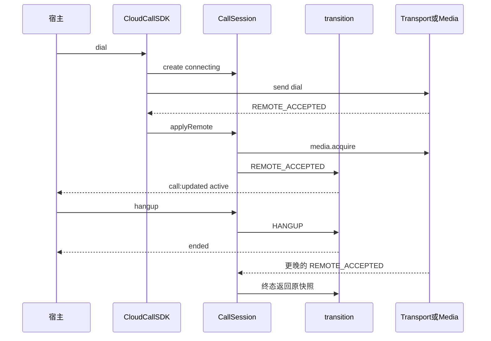

# 第五阶段：面试准备稿

细节和追问在 [01-architecture.md](./01-architecture.md)、[02-ranking.md](./02-ranking.md)、[03-stories.md](./03-stories.md)、[04-gaps.md](./04-gaps.md)。这篇只放能直接开口的稿子。个人贡献按单次提交处理：若你就是作者，把“仓库里”换成“我”；若不是，保持“仓库里”。

## 1. 项目整体介绍

### 30 秒

这是一个给 CRM 或呼叫中心页面用的云呼叫 SDK。核心不依赖 React 或 Vue，通话阶段由一个显式状态机管理。信令和媒体通过接口注入，所以没有 PBX 时可以用 Mock 把拨号、接通、挂断跑通，测试也不用打开浏览器。仓库同时写了连接层的重连策略和 iframe 消息校验，但这两块还没有接到通话主链上。真实 SIP 我不会说已经完成。

### 2 分钟

业务上要解决的是把软电话嵌进不同前端里，并且用户挂断、信令接通、权限弹窗这三件事会交错完成。如果状态写在页面组件里，每个技术栈都要重新处理一次竞态。

仓库是 pnpm monorepo。`@cloudcall/core` 提供 SDK、会话和纯函数状态机。signaling 包里有 Mock 传输，也有一个独立的 WebSocket 连接管理器。webrtc 包里有浏览器媒体管理和 Mock 媒体。React、Vue 是薄订阅，UI 组件只发命令。

主路径是：init 取 token 并 connect，dial 创建 connecting 会话并发送命令，Mock 随后发出带序号的振铃和接通。接通前先 acquire 媒体。本地挂断把会话打进 ended，之后的接通不能再改回去。销毁会 abort 信号并清掉监听器和去重集。

我用测试来限定结论。状态机测试锁住了终态和旧序号。SDK 测试锁住了重复 init、销毁后的晚到事件和双实例。100 次空适配器创建销毁后，诊断计数是 0。13 个单元测试在本机通过。E2E 只有一条 Mock 主路径，连接管理器只有两条测试。没有线上通话数据。

边界我会主动说：拨号发送失败时会话不会回滚；ConnectionManager 还不是 SDK 的 transport；浏览器媒体没有单测；iframe 没有对端页面。

## 2. 架构与核心数据流

依赖方向：宿主和适配器指向 Core 的接口。Core 不指向 React、Vue 或 SIP.js。

写入会话阶段的只有 `transition`。例外是 `mute` 直接改 `muted` 字段。SDK 用事件把快照推给宿主，宿主再 `getCalls()` 拿列表。终态会话留在 Map 里，只是不再计入并发上限。

更完整的缺陷表在架构文档第 7 节。开口前至少记住这四条：send 失败不回滚、超时定时器在 active 后仍在、远端接通不进命令队列、连接管理器没有入站通话回调。

## 3. 排名

| 顺序 | 故事 | 总分 | 面试里怎么用 |
| --- | --- | ---: | --- |
| 1 | 本地挂断与晚到接通 | 21 | 主故事 |
| 2 | ResourceScope 销毁 | 19 | 主故事 |
| 3 | Headless 端口 | 19 | 主故事，必须带上未接线 |
| 4 | 非幂等命令不重放 | 19 | 被问到网络时再展开 |
| 5 | sequence 丢弃 | 16 | 作为故事 1 的追问 |
| 6 | 命令队列 | 16 | 作为“同步挂断”的修正 |
| 7 | Mock 与能力边界 | 15 | 项目介绍里的诚信边界 |
| 8 | iframe 校验 | 15 | 被问到安全或嵌入时再展开 |

## 4. TOP 3 口述

下面是 2 分钟 STAR。30 秒版和 5 分钟版、10 个追问都在 [03-stories.md](./03-stories.md)，避免两份稿子越改越不一样。练习时先背 2 分钟，再只加追问里你被问到的那一层。

### 故事 1：挂断与接通

**S。** 用户挂断和信令接通都会改同一通会话，中间还夹着麦克风权限。Mock 把这个时间差做成了几百毫秒的延迟。

**T。** 已经挂断的会话不能被晚到接通写回通话中；如果权限弹窗晚到，轨道也要停掉。

**A。** 阶段转换收口到纯函数 `transition`。终态的合法事件为空，函数返回原快照。`applyRemote` 在接通时先 `acquire`，回来后如果已经终态或信号已中止，就 `release` 并且放弃这次写入。本地 `hangup` 在它的队列任务里、发送网络请求之前写入终态。

**R。** 单测断言挂断后再接通，得到的是同一个对象。销毁后再投递接通，状态仍是 ended。没有线上误接通数据。还没测的是：媒体等待中途挂断，以及两条不同 messageId 的接通。队列里若还有未完成的保持，挂断要等前一个任务才写终态。

### 故事 2：销毁

**S。** 页面卸载时，取 token、连接和媒体请求可能还没返回。

**T。** 这些回调不能把已销毁实例再写成 ready，订阅和定时器要能卸掉。

**A。** `ResourceScope` 持有 AbortSignal 和清理函数。`dispose` 先 abort，再逆序执行清理。`init` 在 await 之后检查信号。销毁是终态，Playground 用新的 React key 创建新实例。

**R。** 并发 init 只连接一次，并发 destroy 只断开一次。100 次空适配器循环后，calls、listeners、seenMessages 都是 0。这不包含真实 socket 和轨道。scope 对象目前不会换成下一代，失败重试复用同一个 scope。

### 故事 3：端口

**S。** 宿主可能是 React、Vue，测试则希望跑在 Node 里。真实 SIP 环境这个仓库没有。

**T。** 状态机只能有一份，框架和传输都要能替换。

**A。** SDK 构造函数注入 transport、media、host。Core 不依赖框架。React 和 Vue 只订阅快照。Playground 注入 Mock，故障开关改的是下一次发送结果。

**R。** Core 测试不需要 jsdom 就能跑状态和生命周期。框架是 peerDependency。我不会把这件事说成多宿主已经上线：连接管理器、浏览器媒体和 iframe 客户端都还没有接到 `createCloudCall` 的通话链上。token 的返回值也没有传给传输层。

## 5. 原理和追问怎么练

每个故事在 `03-stories.md` 末尾有 10 问。练习方法：

1. 先盖住答案，用自己的话讲。
2. 答案里凡是写着“需要我补充”的，不要说成“我们已经测过”。
3. 故事 1 至少能默画两条时序：队列空闲时的挂断，以及 acquire 等待中的挂断。
4. 故事 4 只在面试官问到重连时打开，第一句就说它还没适配进 SDK。

## 6. 简历表述

### 项目名称

CloudCall 云呼叫前端 SDK（参考实现 / 预研）

标题里保留“参考实现”或“预研”。去掉它，面试官会默认你已经打过真实电话。

### 一段描述

面向 CRM 与呼叫中心宿主的无界面通话 SDK。用显式状态机统一本地控制和信令事件，处理挂断与晚到接通的交叉；用 AbortSignal 作用域取消初始化、定时器和订阅。信令与媒体通过端口注入，React/Vue 只订阅快照。仓库包含可故障注入的 Mock 工作台、13 个单元测试和一条浏览器主路径。真实 SIP、ICE 和连接层到会话层的适配尚未接入。

### 可以写的子弹

- 设计通话状态机和会话命令队列，终态忽略晚到接通；用单测锁定“返回原快照”和销毁后的晚到事件。
- 用 ResourceScope 管理 AbortSignal、退订和定时器；100 次创建/销毁后 SDK 诊断计数归零（空适配器，非堆快照）。
- 在独立连接层实现非幂等控制命令默认不重放、请求超时摘除 pending、带抖动的指数退避；该层尚未适配为 SDK 传输端口。
- 以 pnpm workspace 拆分 Core、信令、媒体和框架绑定，Core 无框架运行时依赖，TypeScript 开启 strict 与 exactOptionalPropertyTypes。

### 不要写的子弹

- 提升接通率、降低投诉、优化 80%、支撑百万并发。
- 基于 WebRTC 统计做了弱网策略。
- 落地微前端云呼叫。
- 使用 useSyncExternalStore / XState / replaceTrack。

### 技术栈一行

TypeScript、pnpm workspace、Vitest、Playwright、Vite、React 19、Vue 3。WebSocket 与 getUserMedia 只写到对应模块，不写成完整 WebRTC 通话栈。

## 7. 需要补充的指标

没有这些数之前，简历用“测试锁定了某条不变量”，不用“提升了百分之多少”。

| 指标 | 怎么测 | 现在有什么 |
| --- | --- | --- |
| 状态机纯函数耗时 | `pnpm benchmark`，记录 CPU、Node、Vitest 版本 | 2026-10-13 一次本地结果约 5.14e6 ops/s。无优化对照 |
| 包体积 | 构建后 gzip `packages/core/dist/index.js`，以及宿主已有 React 时的增量 | 无 |
| 销毁是否留下轨道 | Chrome 真实 getUserMedia，destroy 前后 `track.readyState` | 无。100 次测试不含轨道 |
| 竞态窗口 | fake timer + deferred acquire | 无用例 |
| 拨号失败后的残留会话 | send reject 后 `getCalls()` 和再次 dial | 读代码可知会残留，没有断言 |
| 命令队列延迟 | hold 的 send 耗时与随后 hangup 的状态变化时刻 | 无 |
| 去重集内存 | 长时间拨号后 `diagnostics().seenMessages` | 字段有，无长时间样本 |
| E2E 稳定性 | 重复跑 `playground.spec.ts` | 用例在，本轮未跑 |
| 重连退避分布 | mock `Math.random` 后的等待序列 | 无 |

## 8. 技术债与演进

### 现在就会在追问里碰到的债

- `dial` 在发送前创建会话，发送失败不回滚，超时也还没登记，并发名额被占住。
- 振铃超时不在进入 `active` 时清除。`holding` 到点会因为非法 `TIMEOUT` 抛错。`reconnecting` 到点会被错误地以超时结束。
- 两条接通可以并发 `acquire`。第二条 `apply` 抛错，且 `void applyRemote` 没有接住。覆盖 Map 可能留下未 stop 的轨道。
- 终态会话和 `seenMessages` 只在 destroy 时清空。
- `ConnectionManager` 没有通话消息出口，也没有适配器。
- `getAccessToken` 的结果被丢弃。`error` 事件没有发送方。`ending`、`network-error`、`NETWORK_LOST` 没有生产路径。
- React 与 Vue 的销毁所有权不一致。React 订阅不是 external store。
- iframe 的 `ready` 不阻挡 `request`，且没有对端。
- 测试不覆盖队列、退避、iframe、浏览器媒体和故障开关。

### 演进顺序

1. 先补正确性：发送失败回滚、取消超时、接通互斥、接住 `applyRemote` 的拒绝，并配测试。
2. 再写传输适配器：fake socket 上的 `ConnectionManager` 实现 `SignalingTransport`，入站消息变成 `TransportEvent`。重连成功后加一个明确的“状态未知，需要快照”结果，而不是自动重播 dial。
3. 然后才是媒体：把 `BrowserMediaManager` 接到远端轨道，`setSinkId` 作用在真正播放的元素上；`getStats` 有采样点再谈阈值。
4. SIP 适配器单独做，用 ADR-006 的环境，不用 Mock 绿灯代替集成测试。凭证保持在宿主后端发放的短期令牌，不进仓库。
5. 状态机只有在出现咨询转接、会议这种正交区域时，再评估 XState。在那之前，把 `ending` 删掉或真正用起来，比引入新库更有用。

### 你需要亲自填的空

- 这次提交里，哪些文件是你设计的，哪些是生成后你改过的。
- 有没有仓库外的生产呼叫系统可以讲。如果有，不要把本仓库的 Mock 数据嫁接过去；分开讲，并准备那个系统自己的证据。
- 若没有生产系统，面试定位就是“我能把实时状态和生命周期设计清楚，并诚实标出未接入的部分”，而不是“我已经负责过运营商级呼叫中心”。
